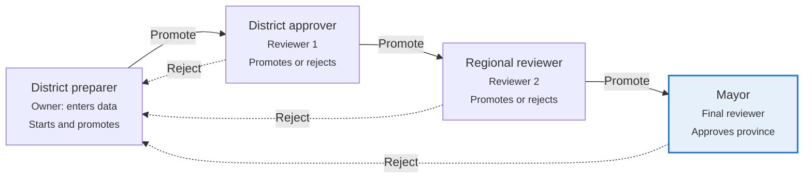
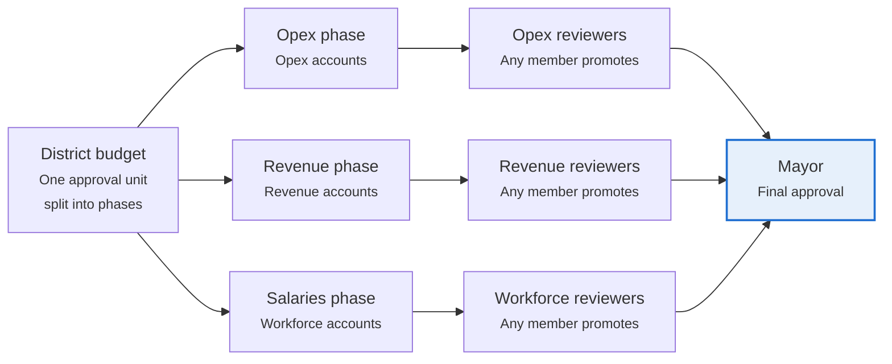
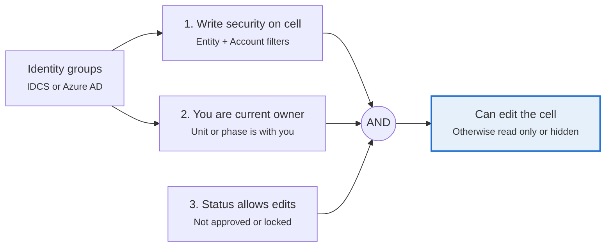
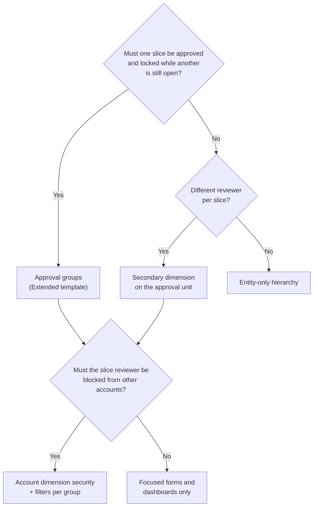

# EPBCS Approval Workflow & Security — Requirements Questionnaire

A workshop toolkit for Oracle EPM Planning (EPBCS / PBCS) implementations. It helps a consultant run the **approvals and security** requirements session and turn the client's answers straight into configuration: the Approval Unit Hierarchy, approval groups, and security.

> **Author:** Dhruv — Senior Consultant, Oracle EPM (EPBCS / PBCS / TRCS)
> **Scope:** generic and client-neutral. The Province → Region → District → Mayor scenario is illustrative.

---

## Why this exists

Approval workflow is usually designed late, and projects run into three problems:

1. **One person per level.** If the only approver is on leave, the budget stops.
2. **"Approval groups" is misunderstood.** In EPM Planning an approval group is a *slice of data* (for example Opex accounts), not a group of users.
3. **Approvals and security are treated as separate topics.** They are not: approvals can only take access away, never give it.

This questionnaire puts all three on the table in a single workshop.

---

## The three ideas at a glance

### 1. Approval path — who moves the budget up

Make each level a **group** (a primary person plus a named backup) so no level depends on one person. If you name individual reviewers, all of them must approve, in the order entered. With a group reviewer, any member can promote.

### 2. Approval groups — reviewing one slice of the budget

Each phase is promoted separately, and one approval unit hierarchy holds up to 20 approval groups. Who can **see** each slice is still decided by security, not by the phase.

### 3. Security — what a user can actually edit

A reviewer who is named in the approval path but has no Write security will find every cell read-only when the budget reaches them.

### 4. Choosing the design from the answers

---

## What's in this repo

| File | What it is |
| --- | --- |
| [`questionnaire.md`](questionnaire.md) | The full questionnaire: Parts A–F, about 60 questions, each with "why it matters" |
| [`templates/questionnaire-template.csv`](templates/questionnaire-template.csv) | The same questions as a blank workshop sheet; open it in Excel or Google Sheets |

### Questionnaire structure

| Part | Topic | Drives |
| --- | --- | --- |
| A | Approval hierarchy and people | Approval Unit Hierarchy, owners, reviewers, template |
| B | Continuity: one person or a group | User vs group owners/reviewers, Take Ownership, Delegate |
| C | Approval groups | Phases per data slice, or a secondary dimension |
| D | Security | Roles, Entity/Account/Scenario/Version filters, access grant matrix |
| E | Process controls | Validation rules, deadlines, notifications, locking, reopen |
| F | Answer → configuration map | The design decision for each answer |

---

## How to use it

1. Send `questionnaire.md` to the client before the workshop.
2. In the session, fill in the CSV template live. Mark open items as `TBC` with an owner.
3. Use Part F to turn the answers into the approval and security design.
4. Log every level still held by one named person, and every slice whose visibility rule isn't agreed yet, as open items.

---

## Sources

Behaviours were checked against Oracle Cloud EPM documentation (November 2026):

- [Assigning Approval Unit Owners and Reviewers](https://docs.oracle.com/en/cloud/saas/planning-budgeting-cloud/pfusa/assigning_planning_unit_owners_and_reviewers.html)
- [About Group-based Approvals](https://docs.oracle.com/cloud/latest/pbcs_common_si/CSPAG/ch09s05s01s04.html)
- [Understanding Approval Groups](https://docs.oracle.com/en/cloud/saas/planning-budgeting-cloud/pfusa/understanding_approval_groups.html)
- [Assigning Approval Groups to an Approval Unit Hierarchy](https://docs.oracle.com/en/cloud/saas/planning-budgeting-cloud/pfusa/assigning_approval_groups_to_an_auh.html)
- [Setting Approval Unit Hierarchy Name, Scope, and Template](https://docs.oracle.com/en/cloud/saas/planning-budgeting-cloud/pfusa/setting_planning_unit_hierarchy_name_scope_and_template.html)
- [Approvals Design](https://docs.oracle.com/en/cloud/saas/planning-budgeting-cloud/pfusa/approvals_design_considerations.html)
- [Planning Unit States](https://docs.oracle.com/cloud/latest/pbcs_common_si/CSPLU/ch10s01s01.html)

---

*Oracle, EPBCS and PBCS are trademarks of Oracle Corporation. This is an independent consultant toolkit, not affiliated with or endorsed by Oracle. It contains no client data.*
