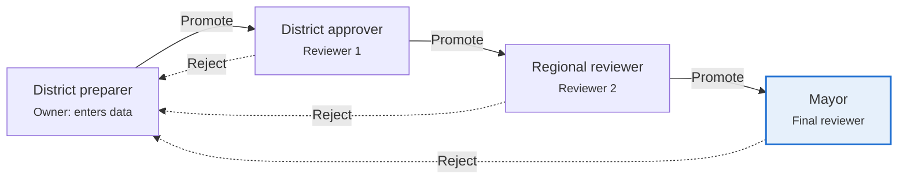
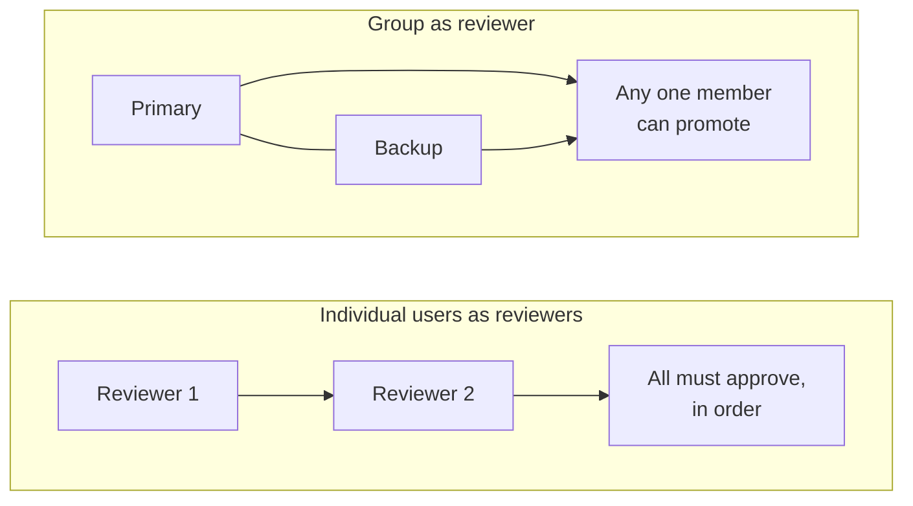
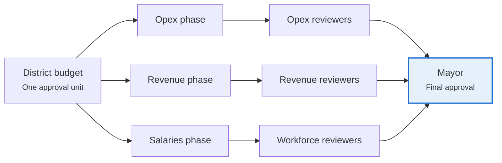
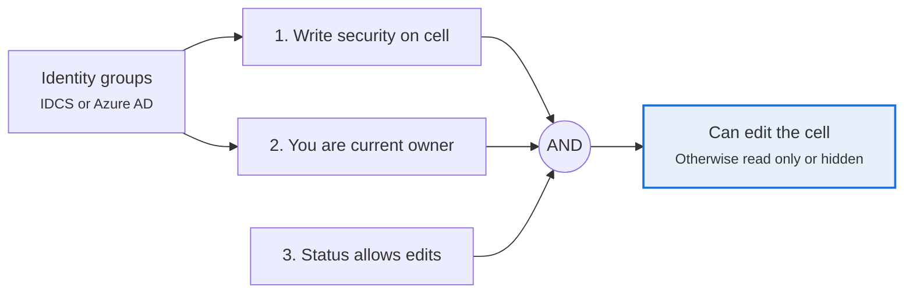
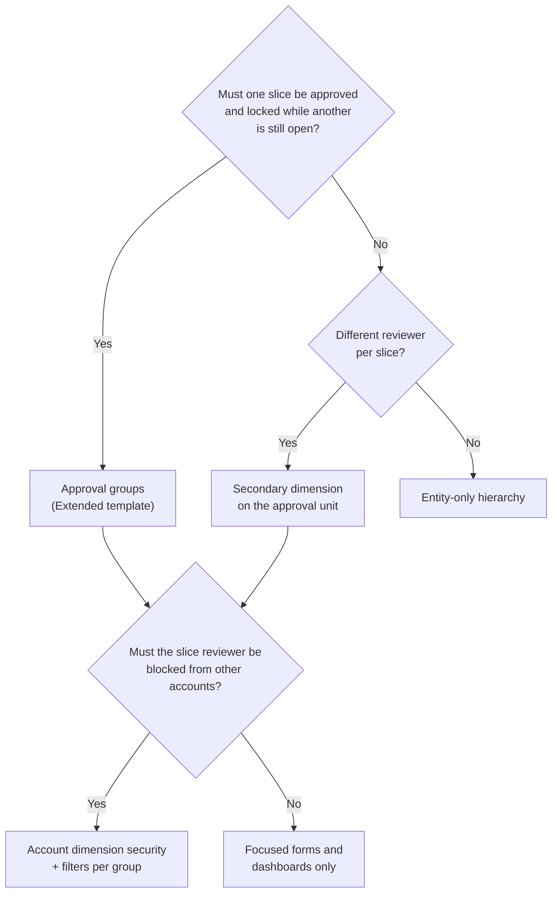

# EPBCS Approval Workflow & Security — Requirements Questionnaire

Use this in the approvals and security workshop to decide three things: who sits at each approval level, which slices of the budget are reviewed separately, and what each person can see and edit at every stage.

**Reference scenario:** Province (top) → Regions → Districts. Districts enter the budget, a district approver approves, a regional reviewer reviews, and the Mayor gives final approval. Replace these labels with the client's own terms.

**Who should attend:** the budget office / FP&A lead, one district preparer, one regional reviewer, someone from the Mayor's office, and the IT or identity owner for Part D.

**How to record:** fill the Answer column during the session (or use [`templates/questionnaire-template.csv`](templates/questionnaire-template.csv)). Write "TBC" plus an owner name where the client can't answer on the spot.

**Contents:** [A. Hierarchy & people](#part-a--approval-hierarchy-and-people) · [B. Continuity](#part-b--continuity-one-person-per-level-or-a-group) · [C. Approval groups](#part-c--approval-groups-reviewing-one-slice-of-the-budget) · [D. Security](#part-d--security-how-it-all-connects) · [E. Process controls](#part-e--process-controls-timing-and-locking) · [F. Answer → design](#part-f--how-the-answers-map-to-the-epbcs-design) · [Oracle behaviours](#oracle-behaviours-relied-on-and-what-is-not-yet-confirmed)

---

## Part A — Approval hierarchy and people

These answers set the Approval Unit Hierarchy: which Entity members are approval units, and the owner and reviewer at each level.

### A1. Structure

| # | Question | Why it matters | Answer |
| --- | --- | --- | --- |
| A1.1 | List every region and the districts under it. Does every district roll up to exactly one region? | Becomes the Entity hierarchy that the approval path follows. | |
| A1.2 | Are there entities that skip a level (e.g. province-level departments with no region, or a district reporting straight to the Mayor)? | Needs its own promotional path or an exception in the hierarchy. | |
| A1.3 | Is the budget entered only at district level, or also below it (departments, cost centres, wards inside a district)? | Decides whether the approval unit is the district or a lower member. | |
| A1.4 | Is there a level between Region and Mayor (budget office, finance department, treasury) that consolidates or adjusts numbers? | Adds a reviewer step, often with edit rights. | |
| A1.5 | Does the same approval path apply to Budget and Forecast, and to every version? | One hierarchy is tied to one Scenario + Version; different paths mean separate hierarchies. | |
| A1.6 | Will new districts be added during the year? Should they join the approval process automatically? | Drives the Auto Include setting. | |

### A2. People at each level

| # | Question | Why it matters | Answer |
| --- | --- | --- | --- |
| A2.1 | Who enters the budget in each district? How many people per district? | These are the district owners/preparers. | |
| A2.2 | If several people enter in one district, do they enter different parts (Opex vs Salaries vs Capex) or the same forms? | Different parts point to approval groups or a secondary dimension (Part C). | |
| A2.3 | Who approves at district level? Is it always a different person from the preparer? | Segregation of duties; first reviewer in the path. | |
| A2.4 | Who reviews at regional level? One person per region, or one person covering several regions? | Regional reviewer on the region parent member. | |
| A2.5 | Does the regional reviewer only review, or also change numbers before sending upward? | If they edit, they need Write security on those districts (Part D). | |
| A2.6 | Does the Mayor approve the whole province at once, or region by region? | Approving a parent approves all its children. | |
| A2.7 | Does anyone need to "sign off" (agree numbers but not yet approve), e.g. the Mayor's office before the Mayor? | Uses Sign Off status instead of a full approval step. | |
| A2.8 | When a reviewer rejects, should the budget go back one level or all the way to the district preparer? | Defines reject behaviour and who owns the unit after a reject. | |

### A3. Direction of the process

| # | Question | Why it matters | Answer |
| --- | --- | --- | --- |
| A3.1 | Do districts build bottom-up, or does the province first send targets or envelopes down to them? | Bottom Up vs Distribute template. | |
| A3.2 | Does the path ever change during the cycle (e.g. owner chooses who to send to next)? | Free Form template, where the user picks the next owner. | |

---

## Part B — Continuity: one person per level, or a group?

One named person per level keeps accountability clear, but the budget stops whenever that person is unavailable. Assigning a **group** as owner or reviewer removes the bottleneck. Oracle behaves differently depending on which you choose: individual reviewers must all approve in the order entered, while any member of a reviewer group can promote to the next level.

| # | Question | Why it matters | Answer |
| --- | --- | --- | --- |
| B1 | For each level (district, region, Mayor), is one named person acceptable, or must someone else be able to act? | Decides user vs group as owner/reviewer. | |
| B2 | Name a backup for every level. Is the backup equal in authority, or only for leave and absence? | A backup with equal authority goes in the same group; leave-only cover can use delegation. | |
| B3 | Where a level has more than one reviewer, must all of them approve, or is any one enough? | All, in sequence = individual users. Any one = a group. | |
| B4 | If a group is the owner, should one person claim ownership first, or can anyone in the group act? | With a group owner and no one claiming, anyone in the group can act for it. | |
| B5 | Can a higher-level reviewer (e.g. region) take over a district's budget if the district is late? | Uses the Take Ownership action. | |
| B6 | Can an approver hand the unit to someone outside the normal path for a while (e.g. an expert)? | Uses the Delegate action. | |
| B7 | Who is the emergency override if a unit is stuck (owner left the organisation, wrong owner)? | Usually a Service Administrator changes status; name them. | |
| B8 | How many days can a unit sit with one person before it escalates? Escalate to whom? | Due dates and escalation in notifications or Task Manager. | |
| B9 | Must the audit trail show which individual acted when a group owns the unit? | Confirms group use is acceptable to internal audit. | |
| B10 | Is the Mayor's final approval allowed to be done by anyone else (deputy, chief of staff)? | The top level is the one most often left as a single person by policy. | |

**Recommended default to propose:** one group per level, each with the primary person and a named backup. Keep a single named user only where policy requires it, usually the Mayor.

---

## Part C — Approval groups: reviewing one slice of the budget

In EPM Planning, an **Approval Group** is a slice of data, such as Opex accounts. It is not a group of users. Each slice becomes its own submission phase that is promoted separately, so Opex can be approved while Revenue is still being worked on. One approval unit hierarchy can hold up to 20 approval groups. The other way to split review is a **secondary dimension** (e.g. Account) on the approval unit, where each District × Account parent has its own owner and reviewer.

*Example split only: confirm the real slices with C1–C5.* Ask the business questions first; pick the design afterwards (Part F).

| # | Question | Why it matters | Answer |
| --- | --- | --- | --- |
| C1 | Which parts of the budget need a different reviewer? (e.g. Opex, Revenue, Salaries/Workforce, Capex, Grants) | Each part is a candidate approval group. | |
| C2 | For each part, who reviews it at district, region and province level? | Owner and reviewer per phase. | |
| C3 | Must one part be approved and locked while another is still open? | Yes = phases (approval groups). No = one approval per district is enough. | |
| C4 | Do the parts have to follow an order (e.g. Salaries before Opex), or run in parallel? | Sets the sequence of phases. | |
| C5 | Is each part defined only by Account, or also by Department, Fund, Program or Project? | Defines the member selection of each approval group. | |
| C6 | Does any account belong to two parts (e.g. salary-related Opex)? Which reviewer wins? | Overlapping cells need a clear rule; avoid overlap where possible. | |
| C7 | Does the split differ by scenario (Budget = all accounts, Forecast = P&L only) or by period (quarter-end only)? | Approval groups can vary by scenario and period. | |
| C8 | Does the Opex reviewer need to see Revenue and other parts (read only), or nothing outside Opex? | Decides whether Account security is needed (Part D). | |
| C9 | Does the Mayor approve each part separately, or the complete district/province once all parts are done? | Final step per phase vs one final approval. | |
| C10 | Are Capex and Workforce budgets prepared in their own modules with their own approvers? | Those may already need their own path or hierarchy. | |

---

## Part D — Security: how it all connects

Approvals never grant access; they only take it away. A user can edit a cell only when all three are true: security gives them **Write** on that intersection, they are the **current owner** of the approval unit (or phase), and the unit's **status** allows editing.

### How the layers stack

| Layer | What it controls | Example for the Province budget |
| --- | --- | --- |
| 1. Identity groups (IDCS / Azure AD) | Who belongs to which group | `GRP_District_North_Preparers`, `GRP_Region_North_Reviewers`, `GRP_Opex_Reviewers`, `GRP_Mayor` |
| 2. Application role | What kind of user they are | Preparers and reviewers = User; budget office = Power User |
| 3. Member security (Entity, Account, Scenario, Version) | What they can see and edit at all | North preparers: Write on North districts; Opex reviewers: Read or Write on Opex accounts only |
| 4. Approval Unit Hierarchy | Who owns the unit at each stage | District North → preparer group → district approver → region reviewer group → Mayor |
| 5. Approval groups (phases) | Which slice is promoted on its own | Opex phase reviewed by `GRP_Opex_Reviewers` |
| 6. Effective access | What the user actually sees at that moment | Layer 3 ∩ current owner (layer 4/5) ∩ status |

**Worked example:** the Opex reviewer is the reviewer of the Opex phase (layer 5). For that to work, `GRP_Opex_Reviewers` also needs Read or Write on Opex accounts for the districts they cover (layer 3). If they must not see Revenue, Account security must be switched on and Revenue left without access. Approval setup alone will not hide Revenue.

### Questions

| # | Question | Why it matters | Answer |
| --- | --- | --- | --- |
| D1 | Where do users and groups come from: created in EPM, or synced from the client's identity system? Who owns group membership? | Group-based approvals depend on groups being kept up to date. | |
| D2 | Agree a group naming convention for preparers, approvers, reviewers and phase reviewers. | One group can then serve both security and approvals. | |
| D3 | For each role, fill in: entity access, account access, scenario/version access (Read / Write / None). | Becomes the access grant matrix. | |
| D4 | When the unit is with a reviewer, can they change numbers, or only comment and approve/reject? | Change = Write security; comment only = Read is enough. | |
| D5 | After a district promotes, should the preparer still see their budget (Read)? | After promotion the previous owner keeps Read only if security gives it. | |
| D6 | Can a district see other districts? Can a region see other regions? | Scope of Read access on Entity. | |
| D7 | Must the Opex reviewer be blocked from seeing other accounts, or is it enough that forms only show Opex? | Blocking needs Account security; hiding needs only form design. Account security adds admin and performance cost. | |
| D8 | Is Actual read-only for everyone? Who can write to the Final or Approved version? | Scenario and version security protect data outside approvals. | |
| D9 | Which business rules can each role run, and on which units? | Rules need launch access and run only on cells the user can write. | |
| D10 | Will users work in Smart View as well as web forms? | The same security applies; confirm users expect it. | |
| D11 | Who maintains owners, reviewers and security when staff change? How often? | Ongoing admin effort and the risk of stale owners. | |
| D12 | Does audit need a regular report of who has access to what? | Access-control and audit reports to plan for. | |

---

## Part E — Process controls, timing and locking

| # | Question | Why it matters | Answer |
| --- | --- | --- | --- |
| E1 | Are there checks a district must pass before it can promote (e.g. no negative values, total within envelope)? | Data validation rules on forms. | |
| E2 | Should some conditions send the budget to an extra reviewer (e.g. new hires > 4 → HR review)? | Validation rules can change the promotional path. | |
| E3 | Is a comment required when rejecting, or when promoting with a variance above a threshold? | Annotations, form instructions, or a validation rule. | |
| E4 | What are the deadlines at each level (district submit, region review, Mayor approve)? | Due dates, Task Manager tasks, reminders. | |
| E5 | Who receives email at each step (owner, next reviewer, budget office)? | Notifiees and user email settings. | |
| E6 | After the Mayor approves, what must happen: lock only, copy Working to Final version, push to reporting? | Lock strategy and post-approval jobs. | |
| E7 | Who can reopen an approved budget, and under what conditions? | Reopen rights and change-control policy. | |
| E8 | How many budget rounds are expected (first draft, revised, final)? Should each round be kept? | Versions per round or one version with reopen. | |
| E9 | What status view does the budget office need (by district, by region, by phase)? | Approvals dashboard or a custom status report. | |
| E10 | Is there a hard cut-off after which no district can edit, whatever its status? | Freeze, scenario start/end periods, or version security. | |

---

## Part F — How the answers map to the EPBCS design

| If the client says… | Configure | Questions |
| --- | --- | --- |
| Districts enter, district approves, region reviews, Mayor approves | Approval Unit Hierarchy on Entity, Bottom Up template, owner = preparer group, reviewers district → region → Mayor | A1, A2 |
| Province sends targets down first | Distribute template | A3.1 |
| Path depends on who the owner picks | Free Form template (user picks next owner) | A3.2 |
| Anyone in a team can act | Group as owner or reviewer | B1–B4 |
| Several approvers must all approve, in order | Individual users as reviewers, in sequence | B3 |
| Region can step in when a district is late | Take Ownership by the higher reviewer | B5 |
| Opex must be approved and locked while Revenue is still open | Approval groups (Extended Approval Flow = Approval Group), one phase per slice | C3, C4 |
| A different reviewer per slice, but everything closes together | Secondary dimension (Account) on the approval unit, or approval groups with one final step | C2, C9 |
| Opex reviewer must not see Revenue | Account dimension security + filters per group, on top of the approval setup | C8, D7 |
| Opex reviewer just needs a focused view | Forms and dashboards that show only Opex; no Account security | D7 |
| Reviewer adjusts numbers | Write access for the reviewer group on those entities/accounts | A2.5, D4 |
| Extra review when a condition is met | Data validation rule that changes the promotional path | E2 |
| Final numbers must be frozen | Lock after approval, copy to Final version, Final version read-only | E6, E10 |

**Open items to log after the workshop:** any "TBC" answer, every level still held by one named person, and every slice whose visibility rule (C8/D7) isn't agreed yet.

---

## Oracle behaviours relied on, and what is not yet confirmed

**Confirmed in Oracle documentation:**

- An approval unit has one owner, which can be a user or a group. Reviewers can be users, one group, or several groups. ([Assigning Approval Unit Owners and Reviewers](https://docs.oracle.com/en/cloud/saas/planning-budgeting-cloud/pfusa/assigning_planning_unit_owners_and_reviewers.html))
- Individual reviewers must all approve, in the order entered. With a group reviewer, any member can promote. With a group owner and no one claiming it, anyone in the group can act. ([About Group-based Approvals](https://docs.oracle.com/cloud/latest/pbcs_common_si/CSPAG/ch09s05s01s04.html))
- Approval groups split an approval unit into phases that are promoted separately, and can vary by scenario and period. Maximum 20 per approval unit hierarchy. ([Understanding Approval Groups](https://docs.oracle.com/en/cloud/saas/planning-budgeting-cloud/pfusa/understanding_approval_groups.html), [Assigning Approval Groups to an AUH](https://docs.oracle.com/en/cloud/saas/planning-budgeting-cloud/pfusa/assigning_approval_groups_to_an_auh.html))
- Templates: None (Entity only), Secondary (secondary dimension), Extended (approval groups). ([Setting Approval Unit Hierarchy Name, Scope, and Template](https://docs.oracle.com/en/cloud/saas/planning-budgeting-cloud/pfusa/setting_planning_unit_hierarchy_name_scope_and_template.html))
- Approving a parent approves its children. A parent whose children were promoted to different users has no owner, and only a Service Administrator can then change its status. Validation rules give conditional paths. ([Approvals Design](https://docs.oracle.com/en/cloud/saas/planning-budgeting-cloud/pfusa/approvals_design_considerations.html))
- Under Review, the owner can edit only with Write access to the approval unit's member combination. ([Planning Unit States](https://docs.oracle.com/cloud/latest/pbcs_common_si/CSPLU/ch10s01s01.html))

**Not confirmed for Planning; verify before you design on them:**

- The precedence rule when one account sits in two approval groups. The rule found is from Financial Consolidation and Close documentation, not Planning.
- Who other than a Service Administrator can create approval group definitions in Planning. The FCCS page says Service Administrator only.
- The real performance cost of Account security in a given cube. Test it on the skeleton build.

*Checked against Oracle Cloud EPM documentation, November 2026.*
