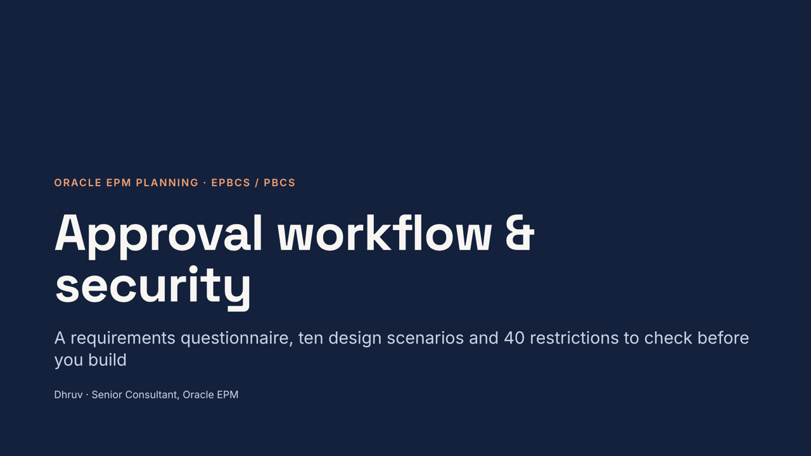
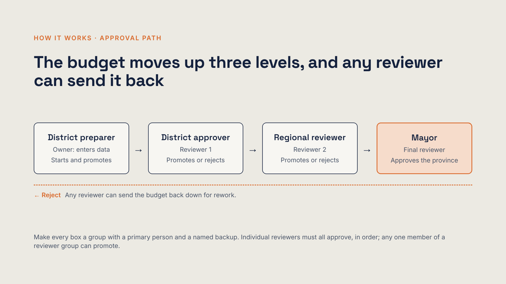
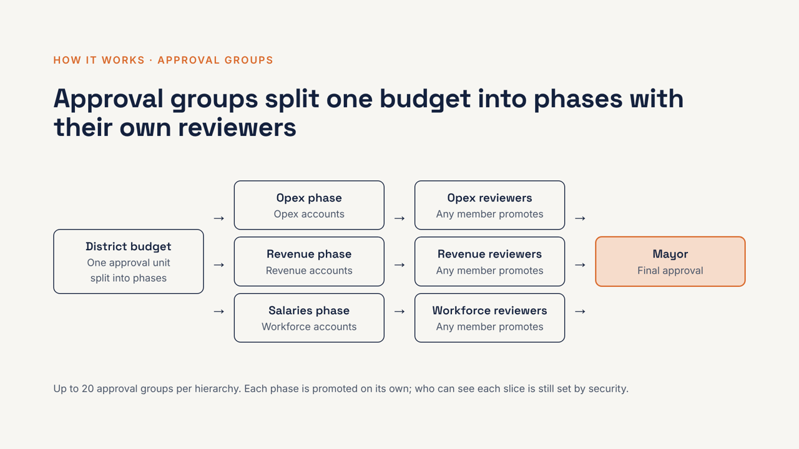
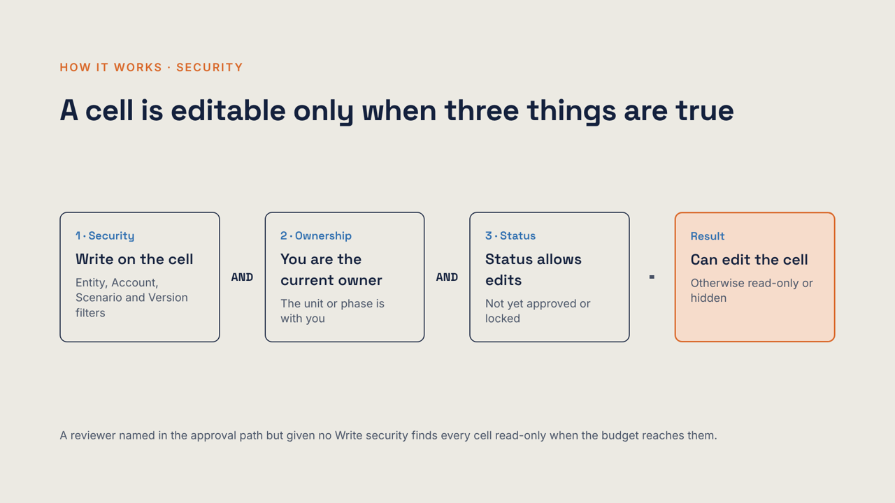
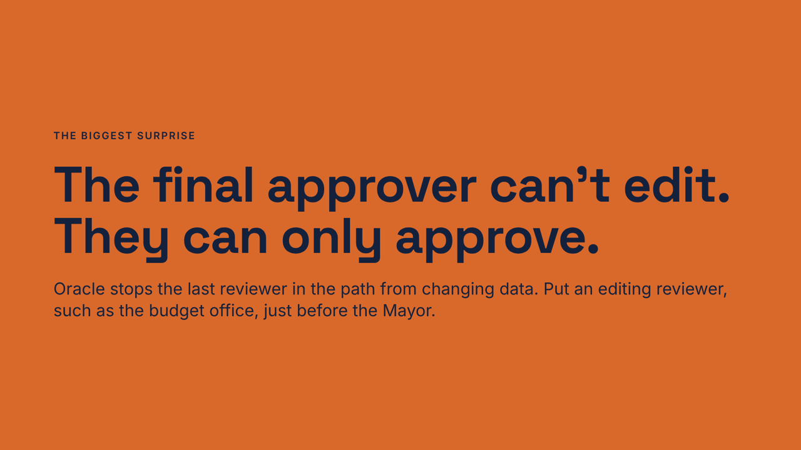
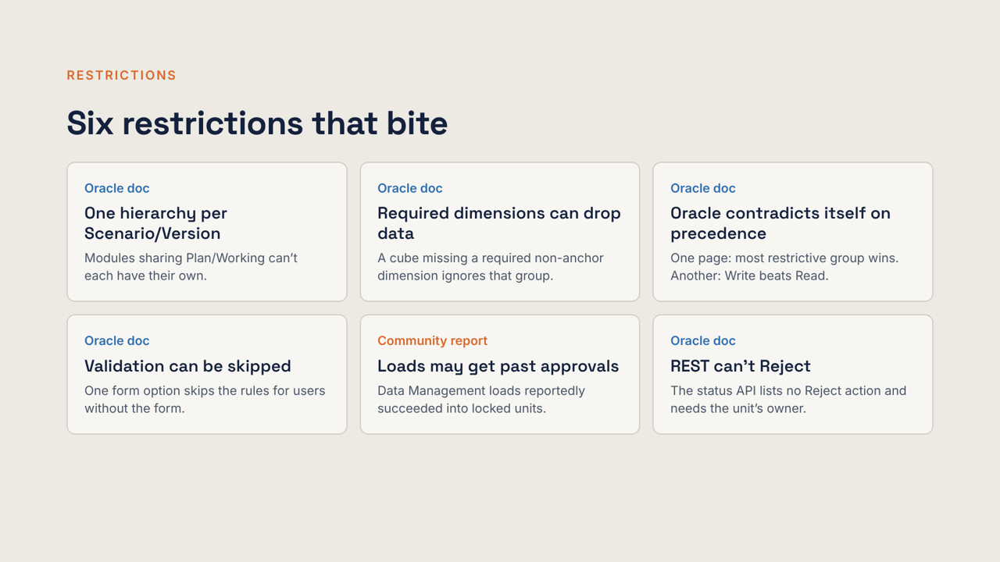

# Slide deck — EPBCS Approval Workflow & Security

**[Download the deck (PDF, 14 slides)](epbcs-approval-workflow-security.pdf)**

A 14-slide summary of this toolkit: how approvals, approval groups and security fit together, how to run the requirements workshop, ten scenarios that use the full feature set, and the restrictions to test before you build.

## Preview

| | |
| --- | --- |
|  |  |
|  |  |
|  |  |

## Outline

| # | Slide | Key message |
| --- | --- | --- |
| 1 | Cover | Questionnaire, 10 scenarios, 40 restrictions |
| 2 | Three things derail approval design | One person per level; approval groups are data slices, not user groups; approvals only take access away |
| 3 | Approval path | District preparer → District approver → Regional reviewer → Mayor; any reviewer can reject |
| 4 | Approval groups | One budget split into Opex / Revenue / Salaries phases with their own reviewers; max 20 per hierarchy |
| 5 | Security | Edit only when Write security AND current owner AND status allows edits |
| 6 | The questionnaire | Six parts, 58 questions |
| 7 | Three design questions | Approval groups vs secondary dimension vs entity-only; Account security or focused forms |
| 8–9 | Ten scenarios | From group approvers with backups to REST/Groovy automation and a Final-version lock |
| 10 | The biggest surprise | The last reviewer in the path can't edit, only approve |
| 11 | Six restrictions that bite | One hierarchy per Scenario/Version, required dimensions, precedence conflict, skipped validation, loads past approvals, no REST Reject |
| 12 | 40 items by area | Hierarchy 9 · Ownership 9 · Approval groups 8 · Security 7 · Emails/automation 7 |
| 13 | Test these 12 first | Skeleton-build tests, run as normal users |
| 14 | Close | Run the workshop, design from the answers, test the gotchas first |
